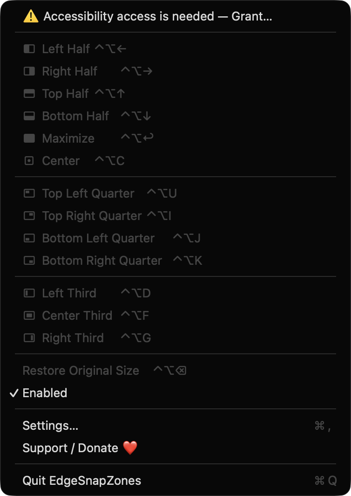
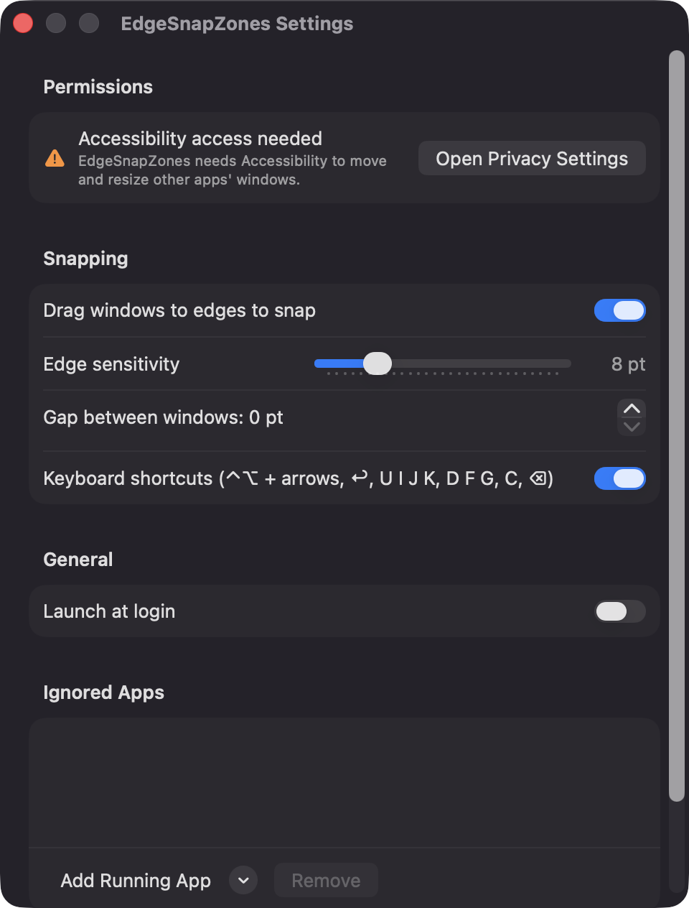

# EdgeSnapZones

**🌐 Website:** [turhe123.github.io/edge-snap-zones](https://turhe123.github.io/edge-snap-zones/)

**Drag a window to a screen edge or corner and watch a preview before it snaps into halves, thirds or quarters.**

> 🆓 A free, open-source **Magnet alternative** for macOS 14+. Native Swift, no accounts, no subscriptions, MIT licensed.


## Why

EdgeSnapZones is a free, open-source, 100% native, backend-free alternative to paid utilities in the *Window Management* category. It was inspired by Magnet ($4.99 one-time) and focuses on the essentials: drag-to-edge snapping with a live preview, plus a small set of keyboard shortcuts. It is written in Swift with SwiftUI and AppKit, has no dependencies, makes no network requests and keeps no accounts or servers.

## Features

- **Drag-to-snap with a live preview.** Drag a window by its title bar to a screen edge or corner. A translucent, blurred, accent-bordered rounded rectangle shows the target frame (it fades in and out and ignores mouse clicks). Release to snap; release outside a zone and nothing happens.
- **Drag zones:**
  - left or right edge → left / right half
  - corners → quarters
  - top edge → maximize
  - bottom edge → left / center / right third (depending on where along the edge the pointer is)
- **Keyboard shortcuts** (global, Control + Option):

  | Layout | Shortcut |
  | --- | --- |
  | Left / Right / Top / Bottom half | ⌃⌥ ← → ↑ ↓ |
  | Maximize | ⌃⌥ ↩ |
  | Top-left / Top-right / Bottom-left / Bottom-right quarter | ⌃⌥ U / I / J / K |
  | Left / Center / Right third | ⌃⌥ D / F / G |
  | Center (keeps window size) | ⌃⌥ C |
  | Restore original size | ⌃⌥ ⌫ |

- **Restore Original Size.** Returns a window to the frame it had before its first snap.
- **Menu bar app.** Lists every layout with its shortcut, an Enabled toggle, Restore, Settings and Quit. It has no Dock icon.
- **Settings:** edge sensitivity (2–30 pt), gap between windows and screen edges (0–40 pt), toggles for drag-to-snap and keyboard shortcuts, Launch at login, and a per-app ignore list.
- **Multi-display aware.** Snaps on whichever screen holds the pointer and respects each screen's visible frame, so the menu bar and Dock are never covered. Zones are recomputed when the display setup changes.
- **Careful about what it grabs.** Only the title-bar strip (top 40 pt) of a standard window starts a snap. Sheets, full-screen windows and the app's own windows are skipped. Fixed-size windows are moved and centered in the zone instead of resized.
- **Debounced preview** so the overlay doesn't flicker when the pointer jitters at an edge.

## Screenshots

<p align="center"></p>

<p align="center"><em>The EdgeSnapZones menu-bar menu lists every snap layout (halves, quarters, thirds, maximize, center) with its Control-Option shortcut, plus Restore, an Enabled toggle, Settings and Support.</em></p>

<p align="center"></p>

<p align="center"><em>Settings let you toggle drag-to-snap and keyboard shortcuts, tune edge sensitivity and window gaps, enable launch at login, and keep a list of apps to ignore.</em></p>

## Install

1. Download `EdgeSnapZones-macOS.zip` from the [latest release](https://github.com/turhe123/edge-snap-zones/releases/latest).
2. Unzip it and move `EdgeSnapZones.app` to `/Applications`.
3. Because the app is open source and not notarized, clear the quarantine flag:

   ```bash
   xattr -cr /Applications/EdgeSnapZones.app
   ```

4. Right-click the app → **Open** the first time you launch it.

## Build from source

Requires macOS 14+ and Xcode with Swift 5.9 or newer.

```bash
brew install xcodegen
xcodegen generate
xcodebuild -project EdgeSnapZones.xcodeproj -scheme EdgeSnapZones -configuration Release -derivedDataPath ./build build
```

The app is produced at `build/Build/Products/Release/EdgeSnapZones.app`.

## Permissions

EdgeSnapZones asks for one permission:

- **Accessibility** (System Settings → Privacy & Security → Accessibility). Required to find the window under the pointer and to move and resize other apps' windows through the Accessibility API. The app prompts on first launch, keeps checking until access is granted, and shows a warning row in the menu and in Settings if access is missing or revoked. Drag detection and shortcuts stay off until it is granted.

It does **not** request Screen Recording, Microphone, Camera, Input Monitoring, or network access. Global shortcuts use Carbon `RegisterEventHotKey`, and drag detection uses a global mouse-event monitor; neither needs extra permissions beyond Accessibility. The only other system integration is the optional **Launch at login** toggle (`SMAppService`).

## Support ❤️

EdgeSnapZones is free and always will be. If it saves you time, you can support its development:

[Support Or (Leo) Davidai ❤️](https://ko-fi.com/leodavidai)

The menu and Settings window also have a "Support / Donate ❤️" button.

## More free Mac apps

EdgeSnapZones is one of [60 free, open-source Mac utilities](https://github.com/turhe123/mac-apps) built the same way: native Swift, no accounts, no telemetry. Browse the full gallery at [turhe123.github.io/mac-apps](https://turhe123.github.io/mac-apps/).

## License

MIT © Or Davidai Bachar
